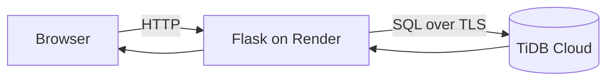

# NSUT Examination Management System


A DBMS project that manages exam logistics: students, faculty, branches, subjects, exams, time slots, rooms, seat allocations and invigilation duties. Built with Flask and a relational database, deployed on Render with TiDB Cloud.

**Live demo:** https://nsut-exam-system.onrender.com (free tier, so the first load can be slow)

## Features

- Role-based login for **admin**, **student** and **faculty**
- Passwords stored as PBKDF2-SHA256 hashes, never as plain text
- Room management through a web form (saved to the database)
- Database covering branches, subjects, exams, exam slots, rooms, seat allocations and invigilation
- Built-in ER diagram page
- Scripts to migrate data and create demo accounts

## Tech Stack

| Technology | Use |
|---|---|
| Python + Flask | Backend and routing |
| HTML / CSS | Frontend pages |
| MySQL / MariaDB | Local database (XAMPP) |
| TiDB Cloud | Cloud database (MySQL-compatible) |
| Gunicorn | Production server |
| Render + GitHub | Hosting and deployment |

## How It Works



The browser sends a request to Flask, Flask runs SQL against the database, and the result is rendered back as a page.

## Database

Tables: `branch`, `student`, `faculty`, `subject`, `room`, `exam_slot`, `exam`, `seat_allocation`, `invigilation`, `user_account`.

See the **ER Diagram** page in the app for the full relationships.

## Project Structure

```
├── app.py              # Flask app: routes and database queries
├── migrate_data.py     # SQLite -> MySQL/TiDB data migration
├── seed_accounts.py    # Creates demo user accounts
├── requirements.txt    # Dependencies
├── Procfile            # Deployment process
├── static/             # CSS and images
└── templates/          # HTML templates
```

## Run Locally (Windows PowerShell)

```powershell
git clone https://github.com/vidita111/DBMS_project1.git
cd DBMS_project1
python -m venv venv
.\venv\Scripts\Activate.ps1
pip install -r requirements.txt
```

Create a `.env` file (never commit it):

```env
MYSQL_HOST=localhost
MYSQL_PORT=3306
MYSQL_USER=root
MYSQL_PASSWORD=
MYSQL_DATABASE=nsut_exam
```

Start MySQL in XAMPP, create the `nsut_exam` database and its tables, then:

```powershell
python migrate_data.py      # load data
python seed_accounts.py     # create demo accounts (change the default passwords)
flask --app app run --debug
```

Open `http://127.0.0.1:5000`.

## Deployment

Deployed from GitHub to Render.

| Setting | Value |
|---|---|
| Branch | `main` |
| Build command | `pip install -r requirements.txt` |
| Start command | `gunicorn app:app --bind 0.0.0.0:$PORT` |

Add the `MYSQL_*` variables in Render's Environment settings. TiDB Cloud needs a TLS connection, so upload its CA certificate as a Render **Secret File**. Never commit credentials or certificates.

## Testing

- Add a room in the web form, then check it in the database:
  `SELECT * FROM room WHERE room_name = 'YOUR-TEST-ROOM';`
- Compare row counts with `SELECT COUNT(*) FROM student;` and the other tables.
- Log in once with each role.

## Future Improvements

Ideas only, not implemented yet:

- Automatic seat allocation that avoids same-subject neighbours
- Faculty duty limits enforced in the database
- A `schema.sql` file and automated tests
- Admit card and door chart views

## Author

Built by **Vidita Sharma** ([@vidita111](https://github.com/vidita111)).
